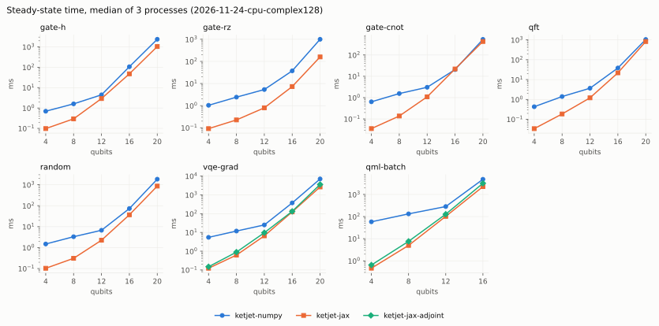
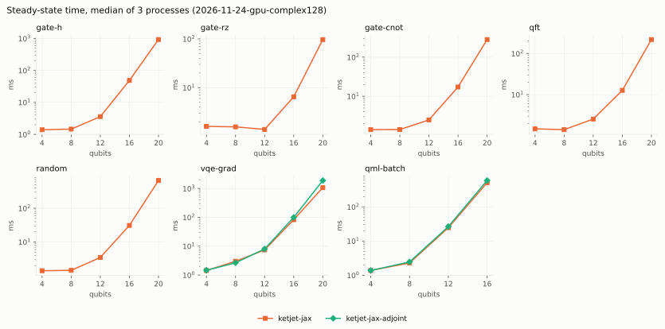
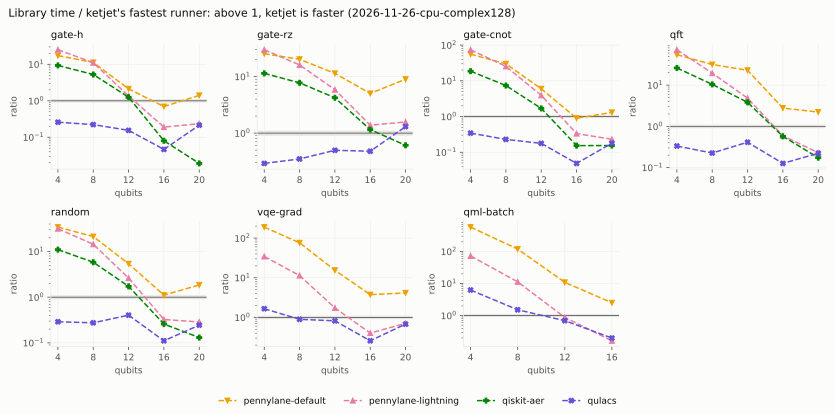
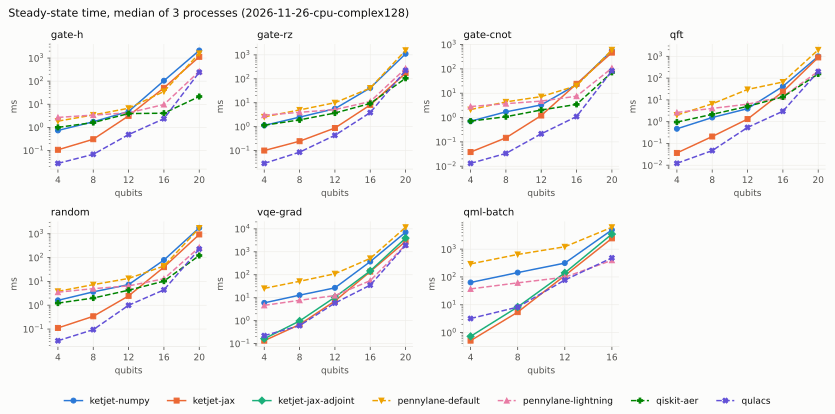
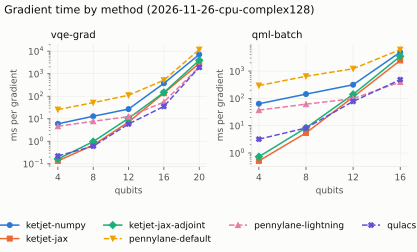
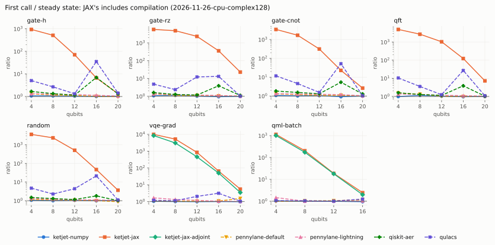

# Benchmarks

ketjet's benchmark suite times five kinds of work on the NumPy and JAX backends and on four other simulators,
and writes the results, with a record of the machine, to `benchmarks/results/`. How it measures is decided in
[ADR-0008](adr/0008-benchmark-methodology.md), and every figure on this page is drawn from the committed
results by one command.

## The benchmarks

| Name | What is timed | Sizes |
|---|---|---|
| `gate-h` | 10 layers of Hadamards on every qubit, a dense single-qubit gate | 4 to 20 qubits |
| `gate-rz` | 10 layers of `RZ` on every qubit, a diagonal gate | 4 to 20 qubits |
| `gate-cnot` | 10 layers of CNOTs on neighbouring pairs, a permutation | 4 to 20 qubits |
| `qft` | The quantum Fourier transform: Hadamards, controlled phases and SWAPs | 4 to 20 qubits |
| `random` | 8 layers of a random rotation per qubit and CNOTs on random pairs | 4 to 20 qubits |
| `vqe-grad` | The gradient of a transverse-field Ising energy, for a 4-layer hardware-efficient ansatz | 4 to 20 qubits |
| `qml-batch` | The gradient of a classifier's mean output over a batch of 32 inputs, with respect to its weights | 4 to 16 qubits |

The state benchmarks start with a layer of `RY` rotations whose angles are inputs, so that no compiler can work out
the answer ahead of time. Every circuit and angle is seeded, so every run and every library gets the same ones.

Each benchmark runs on these **runners**:

- `ketjet-numpy`: the NumPy backend, as `Circuit.state()` or `gradients.grad(..., method="adjoint")`. Batches are
  a Python loop.
- `ketjet-jax`: the JAX backend, compiled, with JAX's own reverse mode for gradients and `jax.vmap` for batches.
- `ketjet-jax-adjoint`: the same with `diff_method="adjoint"`, for the two gradient benchmarks.

And the other simulators, on the CPU (QS-1103):

| Runner | Library | Gradients | Batches | Precisions |
|---|---|---|---|---|
| `pennylane-default` | PennyLane's `default.qubit` | backprop, with autograd | a Python loop (see below) | complex128 |
| `pennylane-lightning` | `lightning.qubit`, PennyLane's C++ simulator | its adjoint method | parameter broadcasting | complex128, complex64 |
| `qiskit-aer` | Qiskit Aer's statevector simulator | none of its own: state benchmarks only | | complex128, complex64 |
| `qulacs` | Qulacs | `ParametricQuantumCircuit.backprop` | a Python loop | complex128 |

Each benchmark circuit is built once, as a ketjet circuit, and translated gate by gate into each library's own
API (`benchmarks/libraries.py`), with the same gates and angles. Each library runs with its default options
and all cores, and its circuit is built outside the timer. Every translation is checked against ketjet's
oracle before it's timed, which is what found the conventions that differ:

- Qiskit and Qulacs number qubits from the least significant bit, ketjet and PennyLane from the most.
- Qulacs's rotation gates turn the opposite way to everyone else's, so its angles and gradients are negated.
- Qiskit's default transpiler removes the QFT's final SWAPs and permutes the qubits instead, which returns a
  different state. Aer runs every benchmark gate natively, so the circuits aren't transpiled.
- `default.qubit`'s parameter broadcasting fails under autograd from 12 qubits, with "shape-mismatch for
  sum" (PennyLane 0.45.1). Its QML batch is a Python loop, as ketjet's NumPy runner's and Qulacs's are.

The libraries are pinned in their own dependency group, `bench`, which users and the normal test run never
install. CI installs it in one job and checks every translation at 3 and 4 qubits, in both precisions where a
library has them (`tests/integration/test_comparison_libraries.py`).

## How it measures

Following ADR-0008:

- **The first call is reported separately.** For JAX it includes the compilation, which can take seconds. The
  headline time is the steady state, the time of later calls.
- **Every answer is checked first.** The first call's result is compared with the NumPy backend's in complex128,
  at the test suite's tolerances. A wrong answer stops the run; it is never timed.
- **Two warm-up calls, then samples of at least 0.2 s.** Fast calls are repeated within a sample. There are 15
  samples, or 5 for a call over 10 s.
- **Each case runs in three fresh processes.** The reported time is the median of the three medians, with the
  interquartile range. The spread between the processes is stored too.
- **JAX results are synchronized** with `block_until_ready`, so a GPU's time is the time until it has finished.
- **GPU calls under 10 ms are marked dispatch-bound,** because their timings are mostly kernel launches.
- **A ratio between 0.9 and 1.1 is "no clear difference",** not a win or a loss.

## Running it

In the GPU workstation image ([GPU workstation](dev/gpu-workstation.md)), from the repository:

```bash
uv sync --group bench                              # the other simulators
uv run python -m benchmarks.run                    # everything on the CPU
uv run python -m benchmarks.run --device gpu       # the JAX runners on the GPU
uv run python -m benchmarks.run --benchmarks qft,vqe-grad --sizes 8,12 --quick
uv run python -m benchmarks.compare benchmarks/results/<file>.json   # ketjet against the others
uv run python -m benchmarks.plots                  # redraws every figure from the JSON
```

`--quick` (one process, five samples) and `--smoke` (one call, 3 qubits) are for development. They are written as
`unpublished-*.json`, which git ignores. CI runs every benchmark at 3 qubits on every pull request
(`tests/integration/test_benchmark_suite.py`), so the suite can't stop working unnoticed.

While a run is going, the machine should be plugged in and otherwise idle: no games, video or other heavy programs
(ADR-0008 D6).

## The result files

Each run writes one JSON file, `benchmarks/results/<date>-<device>-<precision>.json`. It holds:

- `machine`: the date; the CPU, cores, memory, GPUs and NVIDIA driver; the OS, kernel and WSL version, Python, the
  git commit, the Docker image ID and every library's version; thread and device environment variables, and the
  memory cap.
- `settings`: the sample settings used, and whether they're the published ones.
- `cases`: one entry per benchmark, runner and size, with the median, quartiles, minimum, first call, gate and
  parameter counts, and every process's own samples.

- `failed`: any case that failed, with the end of its error: an exception, a wrong answer or running out of
  memory. The larger sizes of the same benchmark and runner are then skipped, and the run goes on.

A file without its machine record is rejected (`benchmarks.harness.validate`).

## Nightly regression tracking

ketjet's own speed is tracked every night with [asv](https://asv.readthedocs.io/), on GitHub's hosted runners
(`.github/workflows/nightly-benchmarks.yml`, ADR-0008 D7). The asv benchmarks, in `asv_benchmarks/`, are a
small set on the CPU: a random circuit's state and the VQE gradient, on NumPy and compiled JAX, at 12 and 16
qubits.

- **Commits are compared within one job,** with `asv continuous`: tonight's `main` against the last night's
  commit. The runner's own speed cancels out.
- **A slowdown of more than 10% is rerun once,** and if it's still there, an issue labelled `perf-regression`
  is opened with asv's comparison. The threshold drops to 5% if the runners turn out quiet enough (ADR-0008 D7).
- **The dashboard** is on this site at [/benchmarks/dashboard/](dashboard/), once the first
  nightly run has published it. Its history comes from hosted runners, whose machines vary from night to night,
  so a step in its lines isn't a regression by itself: regressions are judged within one job.
- **Every pull request** runs each asv benchmark once, so a broken one fails CI and not the nightly run.

To compare two commits by hand, or to measure the runners' noise, dispatch the workflow with a `base` commit.
Against a commit whose `src/` is the same, every difference it reports is noise.

## The figures

`uv run python -m benchmarks.plots` draws four figures for each published result file, into
`docs/assets/benchmarks/`, named after the file. A figure never mixes two files, so numbers from two machines or
two runs are never drawn together (ADR-0008 D6).

- `-time`: the steady-state median against qubits for every benchmark and runner, with the interquartile range,
  on log axes.
- `-speedup`: each library's time divided by ketjet's fastest runner's at the same size; above 1, ketjet is
  faster. The grey band is "no clear difference", 0.9 to 1.1.
- `-gradients`: the time of one gradient against qubits, by method: ketjet's adjoint (NumPy and JAX) and
  backprop (JAX), and each library's own.
- `-first-call`: the first call divided by the steady state. For JAX the first call includes compilation.

ketjet's lines are solid and the other libraries' dashed, and every runner has its own colour and marker. The
SVGs are deterministic, and CI checks that the committed figures are what the committed results draw
(`tests/integration/test_benchmark_plots.py`), so a figure can't go stale.

## First results (2026-11-24)

On the GPU workstation: an Intel Core i5-9600K (6 cores), 6 GB for the container, an RTX 4060 (8 GB, driver
610.88), JAX 0.12.0.1, complex128, at commit `199d1ee`. The steady-state median of three processes, in
milliseconds, at the largest size of each benchmark. The full numbers, including the first calls and every size,
are in `benchmarks/results/2026-11-24-cpu-complex128.json` and `2026-11-24-gpu-complex128.json`.

| Benchmark | Qubits | NumPy | JAX, CPU | JAX adjoint, CPU | JAX, GPU | JAX adjoint, GPU |
|---|---|---|---|---|---|---|
| `gate-h` | 20 | 2,364 | 1,042 | | 922 | |
| `gate-rz` | 20 | 1,001 | 160 | | 97 | |
| `gate-cnot` | 20 | 539 | 429 | | 281 | |
| `qft` | 20 | 1,047 | 826 | | 218 | |
| `random` | 20 | 1,842 | 862 | | 661 | |
| `vqe-grad` | 20 | 7,091 | 2,649 | 3,598 | 1,068 | 1,891 |
| `qml-batch` | 16 | 4,849 | 2,258 | 3,188 | 511 | 591 |





What they show:

- **Compiled JAX beats NumPy once it has compiled,** by 1.3 to 6.3 times at 20 qubits on the CPU and by much more
  on small circuits, where NumPy's per-gate Python overhead dominates. The first call, JAX's compilation, takes
  1 to 24 seconds, so a circuit that runs only a few times is faster on NumPy.
- **The GPU helps most where there's the most work per call:** 4.8 times NumPy for the QFT, 6.6 times for the VQE
  gradient and 9.5 times for the batched QML gradient. 26 of the 43 GPU cases take under 10 ms and are marked
  dispatch-bound.
- **Backprop is faster than adjoint** at these depths, by 1.4 times on the CPU and up to 1.8 times on the GPU.
  Adjoint's advantage is memory (ADR-0007), not time.
- **The GPU is far from its memory bandwidth.** A layer of 20 Hadamards on 20 qubits takes about 4 ms per gate on
  the RTX 4060, about 30 times longer than reading and writing the 16 MB state once. The CUDA backend
  (Sprints 12–13) and the roofline analysis (QS-1106) are where that gets measured and fixed.
- **Noise:** the median spread between the three processes was 1.8% on the CPU and 1.4% on the GPU. Nine CPU
  cases spread by more than 5%, all of them JAX cases, with the largest 21% (`vqe-grad`, adjoint, 16 qubits).

## Against the other simulators (2026-11-26, CPU)

The same machine and image as above, at commit `73a0669`, with PennyLane 0.45.1, `pennylane-lightning` 0.45.0,
Qiskit 2.6.2 with Aer 0.18.4, and Qulacs 0.6.14. Every library ran in the same session, one case after another,
all in complex128. The table shows ketjet's fastest runner (always compiled JAX here) against each library at the
largest size. The full numbers are in `benchmarks/results/2026-11-26-cpu-complex128.json` and
`2026-11-26-cpu-complex64.json`, and the table is regenerated with
`uv run python -m benchmarks.compare <file>` (`--all-sizes` for every size).

| Benchmark | Qubits | ketjet, ms | `default.qubit` | `lightning.qubit` | Qiskit Aer | Qulacs |
|---|---|---|---|---|---|---|
| `gate-h` | 20 | 1,132 | 1,591: ketjet **1.4x faster** | 266: ketjet 4.3x slower | 22: ketjet **52x slower** | 243: ketjet 4.7x slower |
| `gate-rz` | 20 | 172 | 1,549: ketjet **9.0x faster** | 271: ketjet **1.6x faster** | 105: ketjet 1.6x slower | 225: ketjet **1.3x faster** |
| `gate-cnot` | 20 | 465 | 606: ketjet **1.3x faster** | 107: ketjet 4.3x slower | 72: ketjet 6.5x slower | 83: ketjet 5.6x slower |
| `qft` | 20 | 894 | 1,987: ketjet **2.2x faster** | 205: ketjet 4.4x slower | 156: ketjet 5.7x slower | 199: ketjet 4.5x slower |
| `random` | 20 | 934 | 1,731: ketjet **1.9x faster** | 268: ketjet 3.5x slower | 122: ketjet 7.7x slower | 228: ketjet 4.1x slower |
| `vqe-grad` | 20 | 2,841 | 11,746: ketjet **4.1x faster** | 2,002: ketjet 1.4x slower | no gradients | 1,927: ketjet 1.5x slower |
| `qml-batch` | 16 | 2,447 | 6,113: ketjet **2.5x faster** | 398: ketjet 6.1x slower | no gradients | 485: ketjet 5.0x slower |









What it shows:

- **ketjet loses on the CPU, as expected.** At the largest sizes it is clearly slower in 17 of 26 comparisons,
  and in 53 of 127 across all sizes. The compiled C++ simulators are 1.4 to 7.7 times faster on most circuits.
  ketjet's own compiled backend is Sprint 8's work (goal G3), and these are the numbers it has to beat.
- **ketjet beats `default.qubit` everywhere** at 20 qubits, by 1.3 to 9 times, and it wins on diagonal gates
  (`gate-rz`) against `lightning.qubit` and Qulacs: JAX fuses the phases.
- **Qiskit Aer's lead on gate layers comes from gate fusion.** It merges neighbouring gates before it
  simulates, which is on by default. Ten layers of Hadamards, which cancel in pairs, become almost nothing, so it
  is 52 times faster there. Its lead on the QFT and random circuits, 5.7 and 7.7 times, is the more honest
  measure.
- **On small circuits ketjet's JAX runner is often fastest,** because it has the least overhead per call: for
  `vqe-grad` it is 34 times faster than `lightning.qubit` at 4 qubits, and `lightning.qubit` overtakes it
  between 12 and 16 qubits. Qulacs, which has the least overhead of all, overtakes it at 8 qubits, and is faster
  at every size on every state benchmark except `gate-rz` at 20 qubits.
- **In complex64** (`lightning.qubit` and Aer only), ketjet is slower in all 12 comparisons, by 1.2 to 7.5
  times, and by 28 times for Aer on `gate-h`.

**Noise and a rerun.** The median spread between the three processes was 1.6% in complex128 and 1.8% in
complex64. ADR-0008 asks for a rerun of the headline cases on another day to land within 5%. ketjet's cases
from 2026-11-24 were rerun in this session, and they came out **9% slower** (median), with only 8 of 77 within
5%. ketjet's code didn't change between the two runs, and the JAX cases slowed as much as the NumPy ones, so the
machine itself ran slower; the first run was in the evening, this one overnight. Comparisons within one run, like
the table above, are unaffected, but numbers from different days shouldn't be compared until the machine's
state (its power mode, CPU clock and temperature) is recorded and held steady.

The GPU comparisons, with `lightning.gpu` and Qiskit Aer on the GPU, are run by hand and come next.
